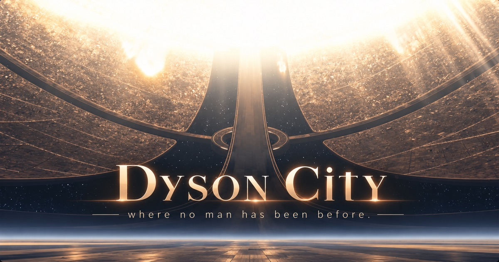

# Dyson City

***Live at https://dyson.scottsun.io***

---

You arrive on a stone apron in front of a gate, and the first thing you do is look up. Everyone does.

There's a star up there, and it isn't a dot. It takes up ninety degrees of sky, a blinding disc whose edge you can't find because its own glare has eaten it. It's 288,000 kilometres away and close enough to fill your peripheral vision. It has been noon here since before anyone thought to keep count.

Look away from it and the ground keeps going: dark warm metal, plate after plate, flat to the horizon. Then it stops being flat. It climbs out of the haze on every side, keeps climbing, and disappears into the glare overhead. That's the rest of the sphere. A single panel up there is the size of a continent. You can see the far side of your own world, and it's lit by the same light that's on your hands.

Past the gate, a hub collar sits on the horizon. Give it twenty minutes and it'll have moved. The band you're standing on turns, the stars beyond the frame slide past, and the frame itself stays exactly where it was.

Then the gate opens.

## Inside

The airlock is a vault. It vents, and the warm garden air in the chamber cools as it expands and turns briefly to mist. Then the inner leaf lifts and it's full noon again, under glass this time.

On your left there's a house: tall, Victorian, many-gabled, with a turret, a deep porch, slate roofs and curtains in the windows. Go in. Your footsteps change as you go from gravel to stone to floorboards. A longcase clock beats seconds in the hall, and its tock comes a fraction late, as real ones do. Somewhere a kettle is simmering. You won't find out who put it on.

Past the garden wall there's nothing green at all. A dark road runs east across pale stone into a field of gold machines: clusters of ribbed towers wearing great halo rings, going up until the Dome tells them to stop; a gimballed sphere turning so slowly you'll check twice; a ring main carried on arches over the road. They're polished enough to reflect each other, the ground, the sky and, small and bent, the house.

There are no people. Nothing tells you where to go. There's nothing to collect. You walk.

## How it's made

Nothing here is painted to look right. The image is worked out from the physics, then bent only where the physics would make it worse.

- **The star is a star.** It's a real-scale photosphere with granulation, spots, flares, prominences and gas bursts off the limb. Almost none of it survives the glare, which is correct: you can't see a sun's texture without a telescope. The detail is still there.
- **Everything is lit by one light.** There's no ambient fill and no art-directed bounce. Interiors are lit by their windows and their lamps, and the lamps are matched to the star's colour so the whole place keeps one warm cast.
- **Distance comes from content, not from fog.** The far shell is lit exactly as brightly as your feet. What tells you it's a million kilometres away is the air in front of it, the detail too fine to count, and the way the stars move.
- **Every sound is synthesised and has a place.** Nothing is played back from a recording. Footsteps, gate hydraulics, leaves, the kettle's bubbles ringing at their Minnaert frequency: each one is built from its mechanism, placed in the world, and carried to your ears through the room it's in.
- **WebGPU only.** It uses three.js with TSL shaders and has no WebGL path and no lower-quality fallback. If your machine can't run it, it says so plainly.

## License

This project is licensed under the GNU General Public License v3.0 (GPL-3.0-only).

You may use, modify, and redistribute this software under the terms of the GPLv3. If you distribute a modified or derivative version of this project, you must also make the corresponding source code available under the GPLv3.

See the [LICENSE](./LICENSE) file for the full license terms.

---

<i>There is no night shift.</i>

