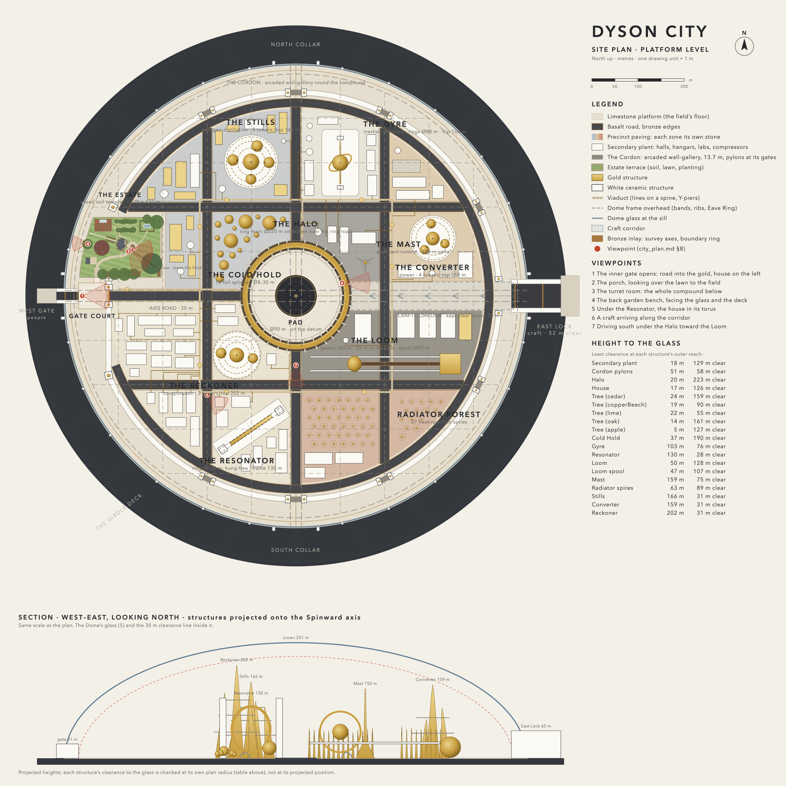

# The City Plan

What fills the Dome. The world it sits in (the star, the sphere, the Veil, the platform, the Dome and the West Gate) is `docs/design.md`.

## 1. The picture

You come in out of the airlock's dim vault into full noon. On your left, behind a stone balustrade and a fringe of old trees, stands a house: a tall, many-gabled Victorian house with a turret, bay windows and a deep porch, a striped lawn running down to a gravel drive, smoke-grey slate roofs, curtains in the windows. It looks lived in. Someone could step out onto the porch with a cup of tea.

Beyond the garden wall there is nothing green at all. A wide, dark road runs straight east across a pale stone plain into a field of gold machines: a ring the size of a cathedral hanging in a cradle of cables, a gimballed sphere turning so slowly you have to look twice, a gantry three hundred metres long with a glowing carriage creeping along it, a cluster of gold-foiled spheres, a mast. They are polished, foiled and precise, and they reflect each other, the pale ground, the sky, and the little house, distorted, over and over. Above all of it the glass of the Dome, the frame turning slowly past, the blinding star and the sphere climbing out of the haze on every side. Now and then a craft glides in through the far end of the Dome, along the axis, and settles at the centre.

**The feeling we are after is a dream.** Every surface tells your eyes this is real. Your reasoning tells you it can't be. The house is calm, cosy and human; the field is cold, lean and immense; neither one is fantasy. The wonder is in putting them together under that sky.

### What makes it work

- **Two truths, side by side.** The house must be as real as a house can be: specific, crafted, worn by use. The machines must be as real as machines can be: every part bolted, plumbed, braced and serviced. If either side slips into the generic or the decorative, the dream turns into a theme park.
- **Contrast, not mixing.** Green, water, wood, softness and warm lamplight exist only inside the estate's wall. Outside it there is no vegetation and no water: stone, gold, ceramic, steel. The wall is a sharp line, not a gradient.
- **The physics of this place does the surreal work.** Eternal noon from a 90° star overhead, soft shadowless light, gold mirrors that throw the world back at itself. Nothing is invented to look strange: it is strange because the place is.
- **Emptiness.** No people. The house is waiting for someone; the machines run themselves; the craft come and go on their own.

### Rejected

- **A generic city.** The first build on `main` filled the Dome with earthly programme (markets, a library, streets of buildings). It was plain, had no identity, and could be anywhere.
- **A "Solar Neoclassical" garden city** of seven refined places, avenues, canals and stoas (the previous `design.md` §7). Same problem at a higher finish: it was a nicer earthly city, not a wonder.

## 2. Light: what the place does to everything in it

These facts come from the world (`docs/world.md`, `docs/shadows.md`) and govern every design choice here.

- **Always noon.** The star is fixed overhead and fills the 45° cone about the zenith. There is no golden hour, no raking light, no long shadows, and no time of day.
- **A 90° source makes almost no cast shadows.** Shadows outdoors are a soft darkening at the foot of things, never a shape. Form has to be carried by **projections that hold shade under them**: cornices, eaves, porch roofs, window hoods, bay undersides, machine overhangs, pipe racks. Design both the house and the machines for top light, as noon architecture is designed.
- **Vertical faces get under a fifth of the light horizontal ones do.** Roofs and tops burn near white; walls model in half-tone; undersides are dark. Colour reads on walls, not roofs.
- **No rainbows, no glories.** A source that large smears them out. Mist reads as soft white.
- **Gold is a mirror of the world.** An up-facing polished gold surface mirrors the star and is as bright as the star. A vertical or curved gold surface mirrors the horizon: the pale platform, the other machines, the house, the far structure's lower sky. The field reads mostly as warm reflections of everything else.
  - So **up-facing gold is satin or foil**, never mirror: the field must not become a field of second suns. Polished gold goes on vertical and curved faces, where it reflects the world.
- **The pale limestone pad bounces light** into every underside, the gold's lower halves and the house's porch.

## 3. Site plan

The Dome is ~1 km across and 251 m high at the crown (`docs/design.md` §7.2). The survey axes cross at the datum in the centre: the **Spinward axis** east–west, the **Meridian axis** north–south.

The site plan ([`city_plan_site.png`](city_plan_site.png)) is drawn to scale, north up, by `tools/site-plan/sitePlan.mjs` (SVG rasterised in headless Chrome); the Dome, gate and frame come from their specs, and the tool checks every structure's clearance to the glass at its own plan radius. Regenerate it with `node tools/site-plan/sitePlan.mjs` whenever the layout here changes; the plan and this document must agree. The numbered red markers are the §8 views.

| Zone | Where | What it is |
|---|---|---|
| **Gate Court** | Inside the West Gate, on the axis | A plain paved forecourt where the road begins; the estate's gateway opens off it to the north |
| **The Estate** | North-west, between the Gate Court and the drum | The house and its garden on a raised terrace, about 170 × 130 m, its back edge following the drum 30 m inside the glass. The house faces inward to the field; its back garden runs to the Dome's glass |
| **The Field** | Everywhere else, inside the Cordon | One walled machine compound: the Cordon (an arcaded wall-gallery) round it, avenues on the Dome's rib lines dividing it into precincts, each zoned and paved in its own stone |
| **Pad and Halo** | The centre, on the datum | The craft landing pad, ringed by the Halo |
| **Craft corridor** | The Spinward axis east of the Halo | Kept clear of anything over ~20 m: craft fly it between the East Lock and the pad |
| **East Lock** | The East Collar | The craft airlock through the Dome |

### Rules of the plan

- **Height follows the Dome.** The tallest structures stand near the centre (up to ~150 m, where the glass is ~240 m up) and step down outward. Everything keeps **≥ 30 m clear of the glass**. The Dome still reads as the enclosing vault; nothing presses against it.
- **Few heroes, one network.** Five hero structures, each one of a kind, and three tower clusters that rise as tall as the Dome allows, all tied together by the compound's infrastructure (§5.3), radiating from the Halo. A plant is a network, not a sculpture park.
- **A compound, not a lot.** The field is walled by the Cordon and divided by avenues under the Dome's ribs into precincts, each with a zone (craft, instruments, power, cryogen, science, works, heat), its own stone, its hero and a dense secondary plant (40–55 % built) of halls, hangars, labs, compressor houses, tank farms and switchyards. Its lanes and the avenues are the open ground; the distances that make the heroes read as huge are now along the avenues and across the core round the Halo. *Rejected:* heroes standing apart on bare limestone, which read as things put on an empty lot.
- **Sightlines are designed.** Each hero is placed for how it reads from the Gate Court, the house's porch, the turret room and the road (§8).

## 4. The house and the estate

The emotional centre: calm, comfort and coziness inside a place of awe. Built in Blender as an exported asset (§9), inside and out, with the most care of anything in the project. The build and its decisions are documented in `blender/docs/house.md`; what follows is the house as built.

### The house

- **Style:** a storybook Victorian: Queen Anne / Second Empire massing. A main block under a slate mansard with five dormers and a widow's-walk deck with iron cresting; a front cross gable with fish-scale shingles, bargeboards and an oculus over a two-storey canted bay; a round corner turret under a bell-cast slate cone; a canted bay at the back; a library/dressing wing on the left and a morning-room/chart-room wing on the right; a deep wraparound porch with a pedimented portico on the door axis, a quarter round about the turret and an east run; bracketed cornices, brick chimneys. It reads as a real house first and a fairy tale second.
- **Size:** true human scale, three storeys plus the attic and the turret room. Floors at 1.05, 5.25 and 9.15 m above grade; the main cornice tops out at 10.25 m, the mansard breaks at 13.5 m, the deck is at 15 m, and the turret's finial at ~20 m. The plan is about 23 × 17 m.
- **Orientation:** the front faces **inward, toward the datum**. The house stands at `HOUSE_SITE` (−372, −112), its front along (0.958, 0.288) in the game plane. The porch looks out over the lawn and the garden wall onto the gold machines; the back faces the Dome's drum.
- **Colour and material** are the one place in the Dome with depth of colour. The house is pale-blue painted clapboard with cream trim, dark slate roofs, green standing-seam metal on the porch roofs, copper finials, red-brick chimneys with terracotta pots, a sandstone base and stained-glass transoms, with curtains behind the glass. Every surface is a procedural PBR material, baked to texture sets for the game.
- **Built for top light.** Deep cornices, porch roofs, window hoods and bay undersides, so the overhead star draws the façade in bands of light and shade.
- **Lived in.** A boot scraper and a coir mat at the door, a watering can, a bicycle against the porch rail, a tea table set for two on the porch. Never staged-new.
- **The story behind it, never told:** someone brought their home here from Earth. The keeper of the compound lives in it.

### The interior

Every room walkable and furnished:

- **Ground floor:** a vestibule and the hall with the main stair; the parlour in the front bay; the dining room in the back bay (walnut wainscot); the library in the left wing; the music room in the turret; the morning room in the right wing; the kitchen with its range and pantry; a rear hall and a WC.
- **First floor:** a landing; the master bedroom in the front bay, with a dressing room and bathroom in the left wing; a second bedroom in the back bay; the keeper's study in the turret (books, globe, desk) and the chart room beside it (plan chest, orrery); a guest room; a bathroom.
- **Top floor, under the mansard:** a top hall, the gable room behind the cross gable's window, the maid's room and a box room.
- **The turret room** at the top: a curved window seat ringed by five windows, a telescope. It is the payoff of the climb: the whole field laid out below, the Halo, the gold, a craft on the pad.
- **Doors work.** Every hinged door opens on its hinge pin as far as the walls and furniture beside it allow; the hall's and parlour's pocket doors slide into the walls.

**Light indoors:** daylight through the windows, baked in Cycles under an HDR of the game's own light at the house site (§9). The lace sheers are drawn back in the day rooms and in the rooms that look out over the field (parlour, dining, library, music room, morning room, study, chart room, landing, gable room, turret room); the bedrooms, the dressing room, the attic service rooms and the kitchen (a valance) keep them drawn. The lamps are lit at their real output, which barely registers against daylight at noon. Indoors is physically dim: the day rooms sit around 6–7 stops below a sunlit white wall outside, the curtained bedrooms and the windowless middle of the house (the hall and the landing) far lower. The eye adapts on entering, but a dim room stays dim and its windows blow out (`docs/render-pipeline.md`). The adaptation range decides how dark the rooms read in play: it reaches 64× (+6 EV) indoors. The windowless hall, landing and top hall get their lamps on at a warm, generous domestic level in the re-bake (`docs/house.md`).

### The estate

- **The garden is one raised bed.** The estate is a terrace of real soil, 1.2–1.8 m above the pad, held by a dressed stone retaining wall with a balustrade on its top, its gateway and steps toward the Gate Court. That makes deep soil for trees plausible, keeps every plant in a bed (nothing grows out of paving), and draws the sharp line between green and field.
- **Inside the wall:** a gravel drive from the gateway to the porch, a mown and striped lawn, mature specimen trees, a small orchard, a kitchen garden, a lily pond (the Dome's air is 1 bar and humid), a glasshouse, clipped hedges, flower borders against the house, climbers on the walls.
- **The carriage house** beside the drive is where the car lives.
- **Framed openings.** The perimeter is hedge and trees with gaps cut into them (claires-voies), so from the garden the machines appear as framed pictures, not a wall of gold.
- **The back garden ends at the glass.** A path, a bench, then the Dome's drum glass, and beyond it the bare metal deck to the horizon with the sphere rising out of the haze: the cosiest place in the game looking out at the end of the world.

## 5. The Field

A science, technology and industry compound: the instruments and plants that a civilisation able to build a Dyson sphere would run at its one city. Only their exteriors exist; none can be entered. They are **plausibly invented**: not copies of real machines, but each with a believable purpose and built the way such a thing would be built.

### 5.1 How it looks

- **Gold leads, never alone.** The gold has a physical reason: it reflects infrared, the standard thermal control for instruments, and the band's flux is 23,000 suns beyond the Veil.
  - **Polished gold:** vertical and curved skins, where they mirror the world.
  - **Satin and brushed gold:** up-facing and broad surfaces.
  - **Gold foil insulation:** crinkled, quilted and stitched over vessels and pipe runs, as on spacecraft.
  - **White ceramic** for primary structure (frames, pylons, plinths) and **glazed black** at every joint and splice, the Dome's own language, so the field and the Dome read as one hand.
  - **Satin bronze** fittings, **graphite steel** mechanisms, chrome hydraulics.
- **Detail at every scale.** A big form with little on it reads as a model (`docs/scale.md`). Every hero carries four levels: its silhouette; its panels and major assemblies; flanges, pipes, ladders, cable trays and hatches; bolts, stitching and seams. From any distance there is more than can be counted.
- **No countable rhythm.** Repeated parts vary in size and spacing as real plants grow; a strict regular array reads human-scale.
- **Motion is slow and large.** A few things move: a gimbal turning, a carriage creeping, a dish tracking, a vent breathing vapour. Slow motion on a huge body is what makes it read as huge.
- **Clean, not grimy.** Maintained, precise, cold. Not cyberpunk, not rust.
- **Soaring, not plant-like.** The field borrows the language of the user's reference image (a city of soaring metal), not its forms:
  - things taper and rise;
  - halo rings circle them on slender spokes;
  - members run in long flowing curves;
  - supports branch;
  - gold leads, with polished chrome and white ceramic beside it.
  Some buildings are genuinely big and tall, up to what the Dome allows where they stand. Every form keeps a working purpose; nothing is ornament. Details are in `docs/field.md`.

### 5.2 The heroes

| Structure | Where | Size | What it is | What you see |
|---|---|---|---|---|
| **The Gyre** | North-east | Outer ring ~90 m across, centre ~55 m up | The compound's inertial reference: a gyroscope that holds its orientation to the stars, against which the band's spin is measured and steered | Three nested gold gimbal rings round a polished gold rotor sphere, carried on bearings in a white ceramic yoke. The band turns under it, so the rotor's axis rolls slowly about the north–south line, once every two hours (3°/min, the sky's own rate): the world's spin, visible in one object |
| **The Resonator** | South-west, the outer science block, its ring facing the house | Ring ~100 m across, frame ~130 m tall | Listens to the star: a cryogenic resonant ring that the star's pressure oscillations, carried through the sphere's structure, set ringing | A flawless polished gold torus hanging free inside a tall ceramic portal frame, suspended on long cables from isolation stages so it touches nothing. Cryostat pods and sensor rings at its rim. Utterly still. The best mirror in the field: it frames the sky and reflects the house |
| **The Loom** | South-east, parallel to the axis | ~320 m long, gantry ~40 m tall, spool ~45 m across | The materials works: draws a continuous ribbon of the sphere's refractory alloy from a travelling furnace head and winds it on a spool | Long ceramic gantry rails on legs; a gold-clad furnace carriage, glowing at its draw-slit, creeping along the rails; at the east end a great gold-flanged spool slowly turning; cable chains, coolant lines, crane trolleys |
| **The Cold Hold** | North-west of the Halo, between the estate and the pad | Spheres 8–34 m across, about 30 of them | The craft's propellant and the compound's cryogen store | A cluster of gold-foiled spherical tanks of power-law sizes on ceramic legs, linked by foil-wrapped pipe runs, valve stations and walkways. Relief vents breathe white vapour now and then. The nearest gold to the house: the house's reflection lives in its spheres |
| **The Mast** | Beside the Halo on the craft corridor's north side | ~150 m tall | Approach and landing control for craft | A slender fluted gold spire on three white ceramic buttress fins (its tripod), ringed by galleries, with a band of phased-array panels and two dish heads that track each craft in and out |

**The tower clusters.** The field's tallest buildings: bundles of lobed, ribbed, brushed-gold towers converging on their tallest, on round podiums, with slit windows between the ribs, buttress arches at their feet and great halo rings round each cluster.

| Cluster | Where | Tallest | What it is |
|---|---|---|---|
| **The Stills** | North, between the Cold Hold and the Gyre | 185 m, five towers | The cryogen distillation columns |
| **The Converter** | East, behind the Gyre | 156 m, four towers | Power conversion: the shell's supply stepped down for the compound |
| **The Reckoner** | South-west, the inner science block by the Halo | 177 m, three towers | The compound's computation, cryogen-cooled |

### 5.3 The network

- **The Halo:** a raised ring main of gold-clad and foil-wrapped conduits round the pad (~110 m radius), on sculpted ceramic arches that straddle the ring road, each line on a stem branching from an arch's back. Cryogen and data branch from it to every hero. Roads pass under it.
- **Viaducts:** a white-and-gold spine on Y-piers. A square main runs just outside the avenues' ring of blocks; trunks along the Axis Road and the Meridian swoop down to it from the Halo's height. Domed valve pavilions (each with its pump set) draw from it into every precinct.
- **The Cordon** walls the compound (`docs/field.md`): an arcaded wall-gallery 13.7 m high and walkable on top, carrying the compound's header lines, with pylons at its gates and the main portal on the Axis Road.
- **Covered trenches** in the pad for power and services, with bronze-edged cover plates.
- **The radiator forest** along the south: heat-rejection spires of varied height, deeply fluted (the fins), with coolant-header rings, that reject the compound's heat.

## 6. Craft

- **The East Lock** is the craft airlock, in the East Collar opposite the West Gate on the Spinward axis. It is the West Gate's construction at a larger size: sector gates, a chamber and a gatehouse through the Dome's skin within the collar's arch (96 m wide, crown at 90 m). Sized for craft up to ~50 m. Part of the Dome, built with step 3.
- **The pad** sits on the datum at the centre: a ~90 m disc of dark heat-resistant ceramic tiles, its markings in bronze inlay, the bronze datum disc kept at its centre, set into the limestone.
- **Behaviour:** craft arrive and leave on their own, never boarded. An arrival comes in level along the band under the Veil (visible from outside, crossing the deck toward the Dome), waits as the East Lock cycles, then flies the craft corridor along the axis at a few tens of metres up, slows over the Halo and settles on the pad. It rests a while, then leaves the same way.
- The craft themselves are separate assets, built in step 4.

## 7. Roads and the car

- **Few roads, all wide** (~20 m), on the Dome's grid: the **Axis Road** from the Gate Court through the Cordon's main portal east to the Halo, the **Meridian** north and south from the Halo to the Cordon's gates, four **avenues** under the rib lines at x, z = ±192, a **ring road** under the Halo and a **perimeter road** inside the Cordon. Every hero stands in a precinct and is reached from the avenues; there are no spurs. The Gate Court opens onto the estate's gateway. The axis east of the Halo is the craft corridor, not a road; it leaves through the Cordon's open craft gate.
- **Surface:** dark polished basalt slabs set flush into the limestone, edged with bronze inlay. No painted markings.
- **The car** lives in the estate's carriage house and is driven by the player round the field. It stays inside the Dome. Built separately in step 4.

## 8. Moments the plan is designed for

These are the acceptance views: when built, each must read as described.

1. **The inner gate opens.** Overexposed for a moment, then: the road running straight into the gold field, the Halo and the Mast at its end, the house and its trees close on the left. The two halves of the dream in one frame.
2. **The porch.** Tea-cup calm: lawn, borders, the balustrade, and over it the field. The Cold Hold's spheres hold small, curved copies of the house.
3. **The turret room.** The whole compound below, the Dome overhead, a craft on the pad.
4. **The back garden.** A bench, the glass, and the endless bare deck outside.
5. **Walking the field.** The Resonator hanging motionless above you, the house reflected in its torus. The Gyre turning so slowly you doubt it.
6. **An arrival.** A craft through the East Lock, along the axis, reflected in everything gold, settling on the pad.
7. **Driving.** Under the Halo, past the Loom's carriage, back up the drive to the house.

**Sound** follows the same split (`docs/audio.md`): inside the estate, birdless garden quiet, a clock, the creak of floorboards, a kettle; in the field, deep cryogenic hum, pumps, the Loom's furnace, the Hold's vents; the craft's arrival heard through the whole Dome. At the garden wall the one fades into the other.

## 9. Build order

1. **The house, inside and out** (Blender). Built: `blender/docs/house.md`. The plan was drawn from the reference images at true scale and placed on the existing site plan; no separate grey-box of the Dome was made.
   - **The interior light is baked in Blender.** The star never moves, so the lighting is static. `tools/house-env.mjs` captures the game's HDR at the house site, and Cycles bakes the following under it, all in the game's one radiance scale:
     - lightmaps for the static architecture of each floor;
     - an SH probe grid through every room for the furniture, doors and windows;
     - a reflection capture for each room.
     
     The capture sees the open site; it is re-run and the house re-baked once the estate exists.
   - **Exported as one bundle, `assets/house.pack`, nothing compressed.** Every entry is used straight from its byte range, with no decoding beyond the browser's own image decoding. The bundle holds:
     - the exterior and each floor as a separate glTF part, so rooms load and cull by portal;
     - textures stored once and shared by all parts, baked from the procedural materials;
     - lightmaps and reflection captures as GPU-ready RGB9E5;
     - the probe grid, and an index with the placement.
     
     *Rejected:* KTX2 textures and meshopt geometry (a decode step at load).
   - **Named for the engine:**
     - collision proxies: shared trimeshes for walls and floors, boxes for furniture, windows and door leaves, ramps for the stairs;
     - door leaves on static rigs, hinged or sliding, with their travel limits and handle positions;
     - lamp empties and sound-emitter empties.
2. **The estate around the imported house.** Built: `docs/estate.md`, `docs/house.md` (the house from R2, streamed; baked interior light; 3D walking; doors; indoor culling to the windows; the estate's sound in `docs/audio.md`). Still to come after the estate is approved: re-capture the game's light with the estate in place and re-bake the house with the lamps on (§4). Procedural: terrace wall and balustrade, drive, lawn, beds, trees and plants (`threejs-procedural-vegetation`), pond, glasshouse, carriage house. Engine work this step needed:
   - **Loading the bundle** and placing the house at `HOUSE_SITE` on the terrace, facing the datum.
   - **Multi-storey walking.** Today the walkable world is one surface height plus plan walls (`docs/player.md`); stairs and upper floors need per-floor floors and walls (the bundle's collision and stair ramps).
   - **Doors** opened and shut by the player, from the rig data in the bundle.
   - **Window glass** for the house. The Dome's glass is an analytic post pass for its ellipsoid only.
   - **Interior light:** the bundle's lightmaps, probe grid and room reflection captures, and the eye-adaptation range that decides how dark the rooms read (§4).
3. **The Field.** The Halo and pad, the five heroes, the tower clusters, the network, roads, and the East Lock in the Dome. Built: `docs/field.md`, `docs/east-lock.md`. The East Lock is a foundation the craft (step 4) will drive.
4. **Vehicles and other moving things.** The car, the craft and their behaviour, separate assets.

Each part gets its own system doc in `docs/` as it is built; this plan stays the overall intent.
